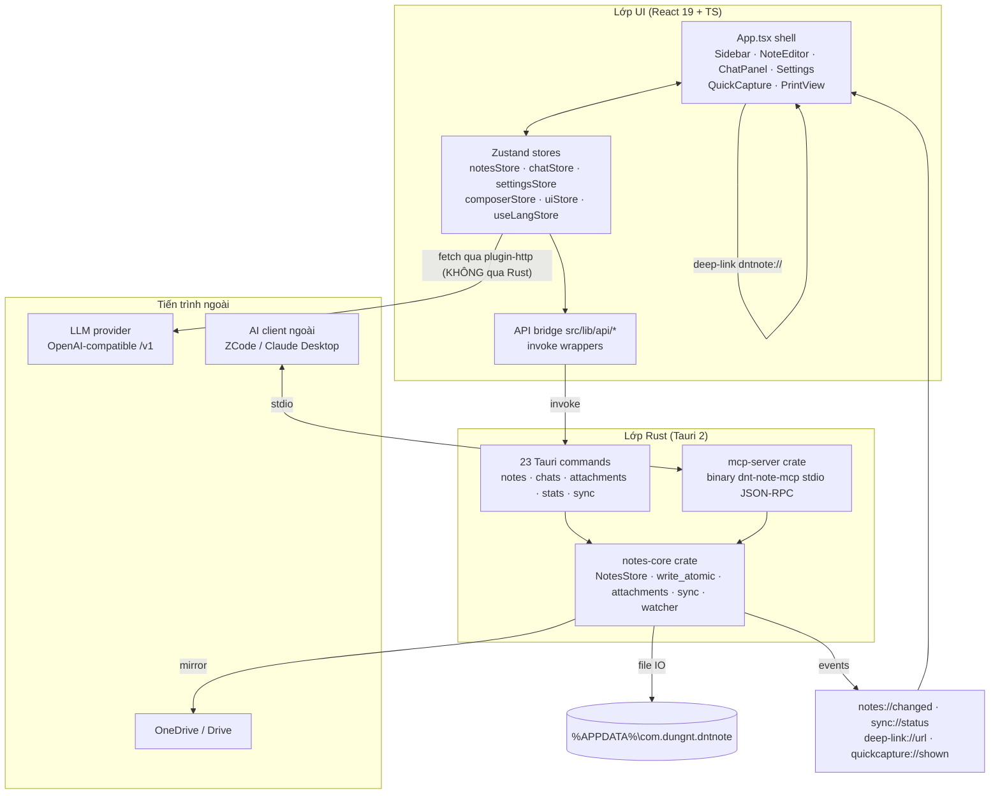
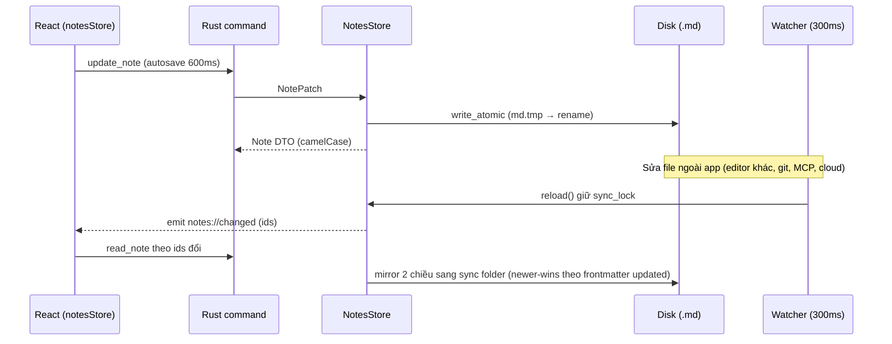

# DNT Note — Kiến trúc hệ thống

> Cập nhật: 2026-09-27 · Version 0.1.0
> Liên quan: [codebase-summary](./codebase-summary.md) · [code-standards](./code-standards.md) · [project-roadmap](./project-roadmap.md) · [deployment-guide](./deployment-guide.md)

## 1. Sơ đồ tổng thể



**Nguyên tắc hybrid:**

| Việc | Nơi xử lý | Lý do |
|---|---|---|
| Agent loop, tool-calling, SSE streaming | **TypeScript** (`lib/agent`, `lib/llm`) | Fetch trực tiếp qua Tauri plugin-http, không CORS, không qua Rust |
| File IO note/chat, watcher, attachments, extract PDF/DOCX, sync mirror | **Rust** (notes-core + commands) | Đường dẫn file, atomic write, debounce native |
| MCP server | **Rust** binary riêng (`dnt-note-mcp`) | stdio JSON-RPC, không cần GUI |

## 2. Crates workspace

| Crate | Vai trò |
|---|---|
| `src-tauri` (app) | Entry `main.rs` → `lib.rs run()`: đăng ký plugin (store → opener → dialog → http → global-shortcut → single-instance → deep-link), setup (NotesStore init, seed demo, orphan cleanup, notes watcher 300ms, sync watcher 500ms, shortcut `Ctrl+Shift+N`, tray, deep-link handler, sync nền ban đầu), invoke handler |
| `crates/notes-core` | Lib thuần, không phụ thuộc Tauri: model note + frontmatter, `NotesStore` (index in-memory `HashMap<id, NoteMeta>`, CRUD, search, tags, trash, `write_atomic`), attachments (extract/resize/orphan), sync mirror, watcher |
| `crates/mcp-server` | Binary `dnt-note-mcp`: stdio JSON-RPC theo dòng, tái dùng notes-core qua path dep — **cùng dữ liệu** với app |

## 3. Vòng đời dữ liệu note



- **Frontmatter 6 trường:** `id, title, tags, pinned, created, updated` — mỗi note 1 file
  `<uuid>.md`, filename stem = id. File hỏng → hiện `⚠ <filename>` read-only.
- **Trash:** delete = rename sang `notes/.trash/`; restore = rename lại + bump `updated`;
  `empty_trash` xóa hết.
- **Search:** không FTS — substring case-insensitive, title match rank cao hơn body.

## 4. Mô hình agent (TS-side)

- `lib/agent/engine.ts` — `runAgent`: vòng lặp tool-calling streaming, **tối đa 12 iterations**
  (`MAX_AGENT_ITERATIONS`); phát events `delta / tool_start / tool_result / pending_delete /
  done / error`.
- `buildSystemPrompt` chèn thống kê notes + note đang mở, hướng dẫn tiếng Việt, quy ước link
  `note://<id>`.
- **10 tools** OpenAI function schema (`lib/agent/tools.ts`): `list_notes`, `search_notes`,
  `read_note`, `create_note`, `update_note`, `delete_note`, `get_stats`, `list_tags`,
  `set_tags`, `get_recent_notes`.
- **An toàn xóa:** `delete_note` không bao giờ xóa — trả `pendingDelete`; UI owns thẻ xác nhận
  trong chat + hoàn tác `Ctrl+Z` (undo delete nằm ở notesStore).
- **LLM client** (`lib/llm/openai.ts`): SSE streaming, ghép tool-call fragment tăng dần
  (`parseSseChunk`, `extractToolCallDelta`), `GET /models`, multimodal ContentPart
  (text | image_url). `initLlmFetch` bind fetch của Tauri plugin-http **một lần lúc khởi động**,
  tự thêm `/v1` vào baseUrl.
- **Budget ngữ cảnh** (`lib/chat/payload.ts`, client-side theo ký tự, không đếm token):
  8k/mention note · 20k/document · 48k tổng.
- Multimodal: ảnh → content part `image_url` (data URL, đã downscale ≤2048px);
  PDF/DOCX/text → extract text. Lịch sử multimodal đang rebuild tham chiếu từ các turn cũ
  (đang triển khai — xem [project-roadmap](./project-roadmap.md)).

## 5. Persistence — 3 tầng

| Tầng | Nội dung | Cơ chế |
|---|---|---|
| Rust files | notes `.md`, `notes/.trash/`, attachments `\<uuid>-\<name>`, chats `\<id>.json` | Ghi atomic; chat JSON pretty + camelCase |
| plugin-store | `providers.json` (AI providers + API key) | Frontend ghi qua Tauri plugin-store; fallback localStorage khi browser |
| localStorage | draft composer (editor JSON, strip data-URL), `dnt-lang`, theme, system mode | Zustand persist / ThemeProvider |

Chi tiết cây thư mục: [deployment-guide](./deployment-guide.md#7-vị-trí-dữ-liệu--backuprestore).

## 6. MCP server

- Binary `dnt-note-mcp`: **stdio JSON-RPC theo dòng**, MCP protocol **2024-11-05**;
  `initialize` → `tools/list` → `tools/call` + `ping`; notification không trả response;
  unknown method → `-32601`, parse error → `-32700`; capabilities `{tools:{}}`
  (không resources/prompts).
- `argv[1]` tuỳ chọn = notes dir; mặc định `%APPDATA%\com.dungnt.dntnote\notes`.
  `store.reload()` trước mỗi message → chỉnh sửa từ app/cloud thấy ngay.
- **7 tools** (mô tả tiếng Việt): `list_notes` (offset/limit ≤50, alias `get_recent_notes`),
  `search_notes` (limit ≤50), `read_note` (char offset/limit, mặc định 20000 — dùng
  `read_body_range()` unicode-safe), `create_note`, `update_note` (partial patch),
  `delete_note` (soft → trash), `open_note` (trả URL `dntnote://note/<id>`).
- Không có tool restore/empty-trash qua MCP (cần xác minh khi mở rộng).

## 7. Deep-link + single-instance + window model

- **Deep-link** scheme `dntnote://`: `dntnote://note/<id>` → emit `deep-link://url` + hiện main
  window; FE mở note tương ứng.
- **Single-instance:** lần launch thứ 2 hiện main + forward argv `dntnote://` thành
  `deep-link://url`.
- **Cửa sổ:**

| Window | Kích thước | Đặc điểm |
|---|---|---|
| `main` | 1280×800 (min 860×560), centered | `decorations: false` — custom titlebar + WindowControls |
| `quickcapture` | 440×170 | `index.html?quick=1`, always-on-top, skip taskbar, ẩn mặc định |
| `print-*` | động | Route `?print=<id>` trong cùng React app, auto `window.print()` sau 600ms |

Print + quick-capture tái dùng cùng React app nhờ route query + alias CSS var legacy.

## 8. Bảo mật — hiện trạng & đánh giá rủi ro

| Mục | Hiện trạng | Đánh giá |
|---|---|---|
| CSP | `csp: null` — tắt hoàn toàn | ⚠️ Rủi ro: nội dung note (Markdown render) không có lớp phòng thủ thứ hai. Cần xem siết khi mở rộng |
| HTTP capability | `http:default` cho phép `https://**` + localhost/127.0.0.1 | ⚠️ Rộng — chấp nhận được vì LLM provider tùy ý, nhưng lưu ý khi thêm origin |
| Capability file | `capabilities/default.json` áp cho main, quickcapture, `print-*`; core/store/opener/dialog/deep-link defaults; global-shortcut register/unregister/is-registered | OK |
| API key | Lưu plaintext trong `providers.json` | ⚠️ Phase 7 dự kiến chuyển sang keyring vault |
| MCP delete | soft-delete (phục hồi được) | OK; chưa có restore/empty-trash qua MCP |
| Sync conflict | newer-wins theo frontmatter `updated` (không phải mtime); file hỏng thua parse được; hoà = không đụng | OK; mirror nền về lý thuyết có thể chạy chồng (chỉ reload giữ sync_lock) — cần xác minh |
| Agent delete | Không thể xóa ngầm: tool chỉ phát `pendingDelete` | OK |

## 9. Bố trí dữ liệu trên đĩa

```
%APPDATA%\com.dungnt.dntnote\
├── notes\<uuid>.md            # ghi chú (frontmatter + markdown)
├── notes\.trash\<uuid>.md     # note đã xóa mềm
├── attachments\<uuid>-<name>  # mọi attachment (note + chat)
├── chats\<id>.json            # phiên chat
├── settings.json              # plugin-store: {onboarded, syncFolder}
└── providers.json             # do frontend ghi (AI providers + key)
sync folder (vd OneDrive): <id>.md mirror + attachments\ copy-only-missing
```

Demo notes: 4 note markdown tiếng Việt trong `src-tauri/resources/demo/` (`include_str!`),
seed lần đầu gated bởi `settings.json:onboarded`.
